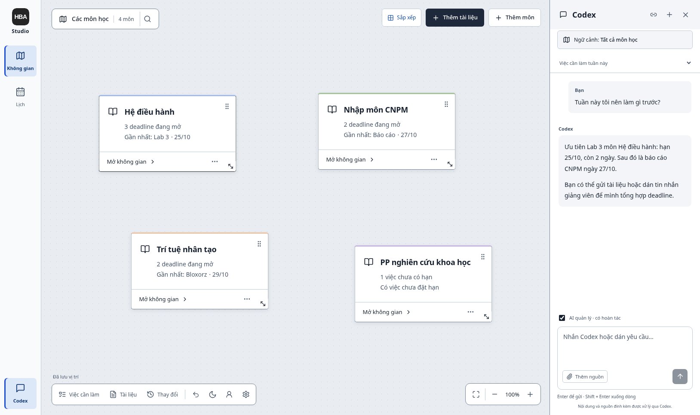

# HBA Studio

A local workspace for courses, projects, deadlines and documents. Arrange your
work on a canvas, keep source material beside each task, and see deadlines in a
calendar. Built with React, TypeScript, FastAPI and SQLite.

[Tiếng Việt](README.vi.md) · [User guide (Vietnamese)](docs/HUONG_DAN_SU_DUNG.md) ·
[Contributing](CONTRIBUTING.md) · [Architecture](docs/ARCHITECTURE.md)

## What you can do

- Organize courses, projects, deadlines, checklists and notes on persistent boards.
- Read PDF, DOCX, XLSX and Markdown beside your work; edit Markdown and, with the
  optional Writer runtime, DOCX. File revisions protect against overwriting edits.
- Search local documents using SQLite FTS5; optionally add multilingual semantic search.
- Review, apply and undo planning changes. Moving cards changes only their layout.
- Optionally connect your own Codex session for chat, document analysis and suggestions.
- Optionally synchronize a dedicated Google Calendar; selected external calendars
  stay read-only. Export and restore local backups.

The interface is currently Vietnamese and scheduling uses `Asia/Ho_Chi_Minh`.
This is a single-user desktop web app served on loopback. AI and Google accounts
are optional: core planning, boards, readers and keyword search work without them.
See [privacy and security](SECURITY.md) for the network and data boundaries.



Synthetic course and chat fixtures; optional Codex integration shown.

## Quick start

Prerequisites: [uv](https://docs.astral.sh/uv/getting-started/installation/),
Node.js **22.18+ within the 22.x line**, and pnpm **11.24.0**. Tool versions are
recorded in `.python-version`, `.node-version` and `frontend/package.json`.
`uv` can install the required Python 3.12 interpreter.

From your clone, on Linux, macOS or WSL:

```bash
cp .env.example .env
bash scripts/run.sh
```

Open **http://127.0.0.1:8765** and choose **Để sau** to skip account setup.
The launcher installs locked dependencies, builds the frontend and starts the app.
Initial installation needs Internet access. Later starts can reuse the build:

```bash
# Use the same environment as the shell launchers.
export UV_PROJECT_ENVIRONMENT="${XDG_CACHE_HOME:-$HOME/.cache}/personal-deadline-management/venv"
uv run --frozen --no-sync pdm
```

For a project-local environment or native Windows, use the portable commands:

```text
uv sync --frozen --python 3.12
pnpm --dir frontend install --frozen-lockfile
pnpm --dir frontend build
uv run --frozen --no-sync pdm
```

On PowerShell, copy the config with `Copy-Item .env.example .env`. Shell launchers
and the optional systemd service target Unix environments. Native Windows and
macOS have not yet been runtime-verified; the default verification platform is Linux.

## Optional features

| Feature | Setup |
| --- | --- |
| Codex | Install the Codex CLI separately, then connect from **Tài khoản & kết nối**. AI requires your own account, network and available quota. Set `PDM_AGENT_ENABLED=0` to disable AI. |
| Google Calendar | Supply your own Desktop OAuth client in the UI or with `PDM_GOOGLE_CLIENT_FILE`. Follow [Google Calendar setup](docs/GOOGLE_CALENDAR.md). |
| DOCX editing | Run `bash scripts/setup.sh --office`, then restart. Downloads about 51 MiB of hash-verified LibreOffice/ZetaJS assets. Read-only DOCX preview works without this download. |
| Semantic search | Run `bash scripts/setup.sh --semantic`, restart, then download the model from document settings. This installs CPU PyTorch and sentence-transformers. Keyword search remains available without it. |
| External Codex MCP | Start the app, then run `bash scripts/connect-codex.sh` and open a new Codex session. MCP exposes five tools and only creates drafts. |

You can combine `--office --semantic`. With a project-local environment, install
semantic support using `uv sync --frozen --extra semantic`, and install Writer
using `uv run --frozen --no-sync python scripts/setup-office-runtime.py --if-missing`.
Use `--source-dir` to install a previously downloaded, verified Writer bundle offline.

## Configuration and data

Copy `.env.example` to `.env`; real environment variables take precedence. See
[configuration reference](docs/CONFIGURATION.md) for all paths and options.

On Linux, the existing defaults are preserved:

- Data: `${XDG_DATA_HOME:-~/.local/share}/personal-deadline-management/`
- Cache: `${XDG_CACHE_HOME:-~/.cache}/personal-deadline-management/`

Other platforms use their normal per-user application directories. `PDM_DATA_DIR`
and `PDM_CACHE_DIR` override these locations. Database, uploads, backups and login
credentials stay outside the source checkout by default. Run only one backend for
each data directory. Stop a running service before starting another backend.

Backups contain personal workspace data and uploads, without login credentials or
original files in watched folders. Restore into an empty directory:

```bash
bash scripts/restore.sh /path/to/workspace-backup.zip --destination /path/to/restored
PDM_DATA_DIR=/path/to/restored bash scripts/run.sh
```

A restored workspace disconnects Google to avoid replaying writes to a real calendar.
On Linux, `bash scripts/install-service.sh` optionally enables the app as a user
systemd service after setup. It does not enable linger.

## Development

```bash
bash scripts/dev.sh
# Separate terminal:
bash scripts/check.sh
```

The development frontend is at **http://127.0.0.1:5173** and proxies the local API.
Backend tests and browser tests use temporary data directories and mocked providers.
To run the complete browser suite, first install its browser and optional Writer:

```bash
bash scripts/setup.sh --office
pnpm --dir frontend exec playwright install chromium
bash scripts/check.sh --e2e
```

[Development guide](docs/DEVELOPMENT.md) explains formatting, isolated environments,
MCP smoke tests and backend-wheel installation. CI runs backend tests, frontend
unit tests/builds, browser journeys and source-release checks.

## Contributing and releases

Bug reports, documentation improvements and focused pull requests are welcome.
Read [CONTRIBUTING.md](CONTRIBUTING.md), [the code of conduct](CODE_OF_CONDUCT.md)
and [the release guide](docs/RELEASING.md) before sharing logs or publishing a copy.
Never include your database, credentials, private screenshots or `.env` in an issue.

Original project code is licensed under [MIT](LICENSE). Fonts, libraries and the
optional Office/model assets retain their own licenses; see
[third-party notices](THIRD_PARTY_NOTICES.md).
