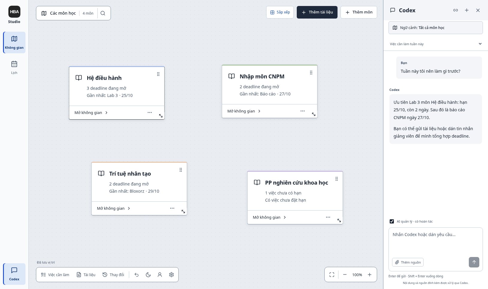

# HBA Studio · PersonalDeadlineManagement

Ứng dụng quản lý môn học, đồ án, deadline và tài liệu chạy trên máy cá nhân.
Bạn có thể kéo thẻ trên canvas, giữ tài liệu cạnh công việc, theo dõi đầu việc và
xem hạn trên lịch. Frontend dùng React/TypeScript; backend FastAPI và SQLite.

[English](README.md) · [Hướng dẫn sử dụng đầy đủ](docs/HUONG_DAN_SU_DUNG.md) ·
[Kiến trúc](docs/ARCHITECTURE.md) · [Đóng góp](CONTRIBUTING.md)



Ảnh minh họa dùng dữ liệu môn học và chat giả lập từ kiểm thử.

## Bắt đầu

Cài `uv`, Node.js 22.18 trở lên trong dòng 22.x và pnpm 11.24.0. `uv` có thể tự cài
Python 3.12. Trên Linux, macOS hoặc WSL, chạy trong thư mục clone:

```bash
cp .env.example .env
bash scripts/run.sh
```

Mở **http://127.0.0.1:8765**. Có thể chọn **Để sau** để bỏ qua kết nối tài khoản.
Script cài thư viện theo lockfile, build frontend rồi chạy backend. Lần cài đầu cần
mạng. Giao diện hiện dùng tiếng Việt, thời gian theo `Asia/Ho_Chi_Minh`.

Với môi trường Python ngay trong dự án hoặc Windows dùng PowerShell:

```text
uv sync --frozen --python 3.12
pnpm --dir frontend install --frozen-lockfile
pnpm --dir frontend build
uv run --frozen --no-sync pdm
```

PowerShell dùng `Copy-Item .env.example .env`. Các script Bash và dịch vụ systemd
phục vụ môi trường Unix. Kiểm chứng hiện thực hiện trên Linux; Windows native và
macOS chưa được kiểm tra trực tiếp.

## Các phần tùy chọn

- **Codex:** cài CLI riêng rồi đăng nhập trong **Tài khoản & kết nối**. Dùng tài
  khoản/quota của bạn. Đặt `PDM_AGENT_ENABLED=0` để tắt AI.
- **Google Calendar:** tự tạo OAuth Desktop client, nhập JSON trong phần kết nối
  hoặc đặt `PDM_GOOGLE_CLIENT_FILE`. Xem [hướng dẫn](docs/GOOGLE_CALENDAR.md).
- **Sửa DOCX:** chạy `bash scripts/setup.sh --office` rồi khởi động lại. Bộ Writer
  khoảng 51 MiB được xác minh SHA-256; đọc DOCX không cần cài bộ này.
- **Tìm kiếm ngữ nghĩa:** chạy `bash scripts/setup.sh --semantic`, khởi động lại
  rồi tải mô hình trong Tùy chọn → Tài liệu. Tìm từ khóa vẫn dùng được ở bản cơ bản.
- **MCP:** chạy backend trước, sau đó `bash scripts/connect-codex.sh` và mở phiên
  Codex mới. Năm công cụ chỉ tạo bản nháp; áp dụng trên web.

Có thể kết hợp `--office --semantic`. Các lệnh dùng môi trường `.venv` thông
thường được ghi trong [README tiếng Anh](README.md) và [hướng dẫn phát triển](docs/DEVELOPMENT.md).

## Dữ liệu và quyền riêng tư

Dữ liệu ở ngoài mã nguồn. Trên Linux, mặc định là
`~/.local/share/personal-deadline-management/`, cache tại
`~/.cache/personal-deadline-management/`; tôn trọng `XDG_DATA_HOME`/`XDG_CACHE_HOME`.
Có thể đổi bằng `PDM_DATA_DIR`/`PDM_CACHE_DIR`. Các hệ điều hành khác dùng thư mục
ứng dụng riêng theo nền tảng. [Tham chiếu cấu hình](docs/CONFIGURATION.md).

Chỉ chạy một backend cho mỗi thư mục dữ liệu. Không dùng dữ liệu thật để chạy
kiểm thử. Không gian, tài liệu gốc và tìm từ khóa hoạt động khi không kết nối AI
hoặc Google. Khi dùng Codex, nội dung/ngữ cảnh liên quan được gửi đến dịch vụ AI;
Google nhận những dữ liệu lịch bạn chọn đồng bộ. [Chi tiết](SECURITY.md).

## Phát triển và đóng góp

```bash
bash scripts/dev.sh
bash scripts/check.sh
# Cài Writer và Chromium trước khi chạy toàn bộ kiểm thử trình duyệt:
bash scripts/setup.sh --office
pnpm --dir frontend exec playwright install chromium
bash scripts/check.sh --e2e
```

Đọc [CONTRIBUTING.md](CONTRIBUTING.md) để biết quy tắc thay đổi, định dạng và kiểm
thử; [RELEASING.md](docs/RELEASING.md) để chuẩn bị đưa lên GitHub. Không đưa file
OAuth thật, token, database, `.env`, ảnh chụp hoặc log chứa dữ liệu cá nhân lên Git.

Mã gốc của dự án dùng [MIT](LICENSE). Thành phần bên thứ ba giữ giấy phép riêng,
được ghi tại [THIRD_PARTY_NOTICES.md](THIRD_PARTY_NOTICES.md).
